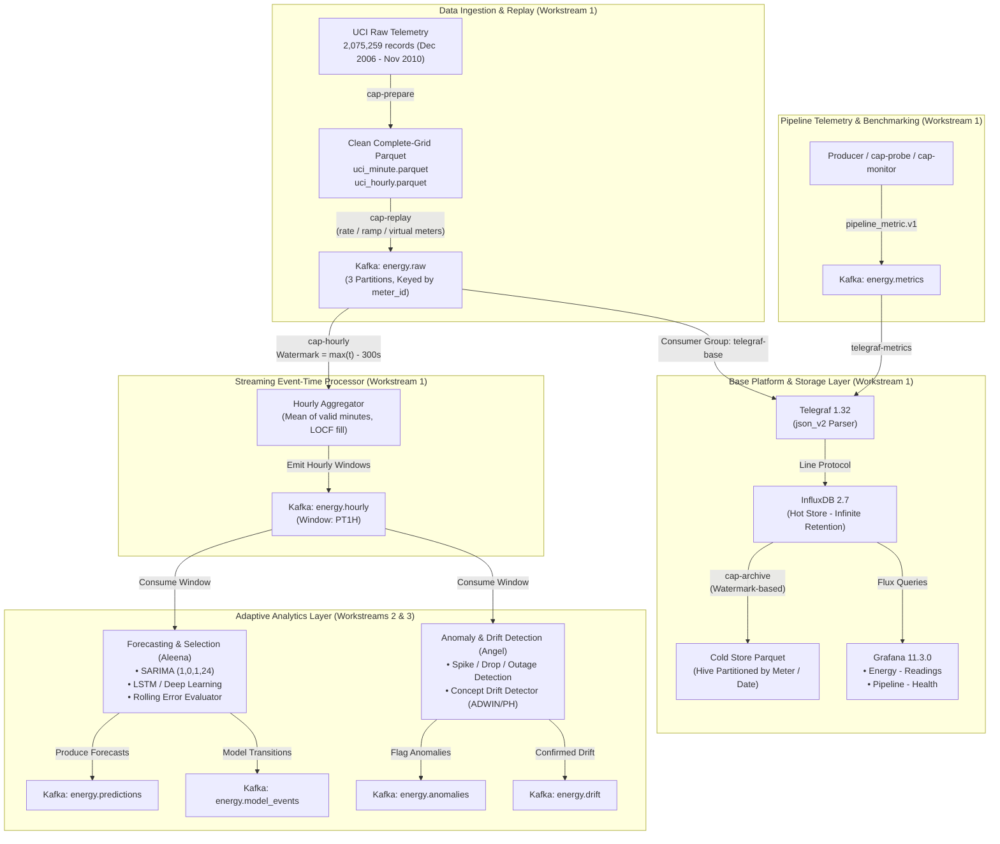

# Real-Time-Energy-Forcasting

> **Adaptive Real-Time Big Data Pipeline for Energy Forecasting: Streaming Anomaly Detection, Concept Drift Detection and Dynamic Model Selection**  
> *Reproducing, modernizing, and extending Im et al. (2024), Frontiers in Big Data 7:1308236.*

[](https://www.python.org/)
[](https://kafka.apache.org/)
[](https://www.influxdata.com/)
[](https://www.influxdata.com/time-series-platform/telegraf/)
[](https://grafana.com/)
[]()

---

## 1. Project Overview

In smart grids and modern energy distribution systems, electrical load telemetry arrives continuously at sub-minute granularity. Real-world streams suffer from sensor dropouts, network partitions, seasonal regime changes (concept drift), and unexpected demand spikes. Traditional static forecasting models degrade quickly when deployed into such non-stationary streaming environments.

This capstone project implements an **end-to-end, adaptive real-time big data pipeline** that:
1. **Streams high-resolution electrical consumption telemetry** through a distributed message broker (Apache Kafka).
2. **Standardizes and enforces a strict event contract** across data, anomaly detection, drift monitoring, and forecasting layers.
3. **Implements streaming event-time aggregation** (1-minute readings to 1-hour prediction windows) with out-of-order and watermark lateness handling.
4. **Maintains a dual-tier storage architecture**: low-latency hot storage in InfluxDB 2.7 and historical cold-tier archival in Hive-partitioned Apache Parquet.
5. **Provides real-time visualization & telemetry**: Grafana dashboards tracking electrical readings and pipeline health metrics (throughput, end-to-end latency, consumer lag, container CPU/RAM).
6. **Enables downstream adaptive intelligence**: Dynamic model selection between statistical baselines (SARIMA) and deep learning models (LSTM), informed by streaming anomaly detection and concept drift signals.

---

## 2. End-to-End System Architecture



---

## 3. Workstream Division & Team Responsibilities

The project is structured into three specialized workstreams:

| Workstream | Owner | Core Responsibilities | Key Outputs |
|---|---|---|---|
| **1. Data / Platform / Integration** | **Ananthan S** *(Branch Owner)* | • System contract & schema authoring<br>• UCI ingestion, M1–M5 missing data rules, Parquet generation<br>• Kafka replay producer with pacing & virtual meters<br>• Streaming 1-hour aggregator (`cap-hourly`) with watermark lateness<br>• Docker infrastructure (Zookeeper, Kafka, InfluxDB, Telegraf, Grafana)<br>• Cold-tier Parquet archival & benchmark telemetry (`cap-monitor`, `cap-probe`, `cap-benchmark`) | `energy.raw`<br>`energy.hourly`<br>`energy.metrics`<br>Docker Compose<br>Dashboards |
| **2. Forecasting & Model Selection** | **Aleena Antony** | • SARIMA (1,0,1,24) baseline model implementation<br>• LSTM neural network forecaster<br>• Online rolling-error evaluation<br>• Dynamic model selection logic triggered by accuracy or drift | `energy.predictions`<br>`energy.model_events`<br>MAE / RMSE Reports |
| **3. Anomaly & Drift Monitoring** | **Angel Treesa John** | • Real-time anomaly detection (spikes, drops, outages)<br>• Concept drift detection (ADWIN, Page-Hinkley, residual monitoring)<br>• Synthetic anomaly injection pipeline on `test` split<br>• Signal dispatch to trigger model adaptation | `energy.anomalies`<br>`energy.drift`<br>Detection Latency & F1 Reports |

---

## 4. Shared Schema Contract v1.0.0

All workstreams strictly adhere to the frozen contract in [`docs/SCHEMA_CONTRACT.md`](docs/SCHEMA_CONTRACT.md) / [`SCHEMA_CONTRACT_v1.0.0.md`](SCHEMA_CONTRACT_v1.0.0.md). Machine-readable JSON Schemas reside in [`src/capstone/schemas/`](src/capstone/schemas/).

### Frozen Decisions

| # | Parameter | Frozen Specification | Rationale / Source |
|---|---|---|---|
| 1 | **Target Variable** | `target` = `Global_active_power` (**kW**) | Im et al. (2024) |
| 2 | **Input Features** | `global_reactive_power` (kW), `voltage` (V), `global_intensity` (A), `sub_metering_1/2/3` (Wh/min) | Six UCI independent measurements |
| 3 | **Time Horizon** | **1-step ahead** (next 1 hour). Forecast for hour $T$ is issued once window $T-1\text{h}$ closes. | Standard hourly operational dispatch |
| 4 | **Prediction Interval** | **1 hour** (`PT1H`), half-open windows $[h, h+1\text{h})$, labelled by **window start**. | Balances granularity and model stability |
| 5 | **Missing Data Rules (M1–M5)** | **Raw minutes are never imputed** (`is_missing=true`, value keys omitted). Hourly windows with no valid target minutes use **Last-Observation-Carried-Forward (LOCF)** with `imputed=true`. | Retains raw data fidelity for anomaly detection; prevents leakage |
| 6 | **Event-Time Watermark** | Lateness buffer = **300 seconds**. Window closes when $\max(\text{event\_time}) - 300\text{s} \ge \text{window\_end}$. | Robust to out-of-order streaming arrivals |
| 7 | **Chronological Splits** | `train`: start to `< 2009-10-01`<br>`val`: `2009-10-01` to `< 2010-01-01`<br>`test`: `2010-01-01` to end of dataset | `train`+`val` = 36 months; `test` = 11 months validation period |
| 8 | **Envelope Standard** | All events carry `schema_version`, `run_id`, `meter_id`, `event_time`, `trigger_event_id`, `trigger_replay_time_ms`, `emit_time_ms`. | Enables true end-to-end latency measurement across the entire distributed pipeline |

### Kafka Topics Overview

| Topic Name | Partitions | Key | Payload Schema | Purpose |
|---|---|---|---|---|
| `energy.raw` | 3 (configurable) | `meter_id` | `energy_raw.v1` | 1-minute telemetry readings from replay producer |
| `energy.hourly` | 1 | `meter_id` | `energy_hourly.v1` | 1-hour tumbling window aggregates for model inference |
| `energy.predictions` | 1 | `meter_id` | `energy_prediction.v1` | Point forecasts and confidence intervals |
| `energy.anomalies` | 1 | `meter_id` | `energy_anomaly.v1` | Real-time outlier and dropout alerts |
| `energy.drift` | 1 | `meter_id` | `energy_drift.v1` | Concept drift status flags and shift magnitudes |
| `energy.model_events` | 1 | `meter_id` | `energy_model_event.v1` | Model retraining and dynamic switching audit trail |
| `energy.metrics` | 1 | `component` | `pipeline_metric.v1` | End-to-end latency, lag, CPU, and memory metrics |

---

## 5. Dataset & Preprocessing

The primary data source is the **UCI Individual Household Electric Power Consumption Dataset** (Hebrail & Berard, 2012).

* **Source File:** `data/raw/household_power_consumption.zip`
* **Raw Sampling:** 1-minute resolution from 2006-12-16 17:24:00 to 2010-11-26 21:02:00 UTC.
* **Total Rows:** Exactly **2,075,259 rows** (verified against Im et al. 2024 §5.2).
* **Missing Minutes:** 25,979 minutes (1.25%).
* **Hourly Windows:** 34,589 total hours; 421 imputed hours (1.21%).

### Content Verification Hashes
To guarantee identical training and evaluation data across all three workstreams, verify with `data/processed/dataset_manifest.json`:
* `uci_minute.parquet` SHA-256: `c918e6e9b06439ef62a1898212af6d15ebce61096fbca8239fc4d2947b7ca179`
* `uci_hourly.parquet` SHA-256: `6e194e999b28de75fd1891d60f80cf904151e8b5e7c30c195451558190a36f77`

---

## 6. CLI Tooling Reference

All utilities are registered entrypoints in `pyproject.toml` (and executable via `python -m capstone.<module>`):

| Command | Entrypoint Module | Description |
|---|---|---|
| `cap-prepare` | `capstone.prepare_data` | Downloads UCI zip, cleans, builds minute grid, aggregates hourly, splits, and computes SHA-256 manifest. |
| `cap-synth` | `capstone.synthetic` | Generates synthetic UCI-format data for offline smoke testing. |
| `cap-topics` | `capstone.topics` | Creates or recreates Kafka topics with explicit partition parameters. |
| `cap-replay` | `capstone.replay_producer` | Replays minute telemetry into Kafka with pacing (`rate`, `ramp`, `speedup`, `max`) and virtual load meters (`uci-001..N`). |
| `cap-hourly` | `capstone.aggregator` | Event-time tumbling window aggregator with lateness handling, emitting to `energy.hourly`. |
| `cap-monitor` | `capstone.monitor` | Background sampler recording consumer group lag, Docker container CPU, and memory to CSV. |
| `cap-probe` | `capstone.latency_probe` | Polling probe calculating true production-to-InfluxDB end-to-end latency and drain times. |
| `cap-archive` | `capstone.archive` | Hot-to-cold tier mover; archives event-time-old data from InfluxDB to Hive Parquet with optional prune. |
| `cap-benchmark` | `capstone.benchmark` | Automated runner executing controlled experimental scenarios from `config/benchmark.yaml`. |

---

## 7. Quickstart & Runbook

### Prerequisites
* **Python 3.10+** (tested on 3.10, 3.11, 3.12, 3.13)
* **Docker Desktop** (with Compose v2 and WSL2 backend on Windows)

### Step 1: Environment Setup
```bash
# Clone the repository
git clone https://github.com/ananthans-Techie/Real-Time-Energy-Forcasting.git
cd Real-Time-Energy-Forcasting

# Create virtual environment & install in editable mode
python -m venv .venv
source .venv/bin/activate  # On Windows: .venv\Scripts\activate
pip install -e ".[dev]"

# Configure environment secrets
cp .env.example .env
```

### Step 2: Prepare the Dataset
```bash
# Download and prepare the official 2M-row UCI dataset
python -m capstone.prepare_data --download

# (Alternative for fast testing: make synth-prepare)
```

### Step 3: Launch Docker Services
```bash
# Start Zookeeper, Kafka, InfluxDB 2.7, Telegraf, and Grafana
docker compose --profile zk up -d

# Initialize Kafka topics with 3 partitions for raw data
python -m capstone.topics --raw-partitions 3
```

### Step 4: Stream Data to the Pipeline
```bash
# Replay 2,000 minutes at 500 records/sec
python -m capstone.replay_producer --run-id smoke-01 --limit 2000 --rate 500
```

### Step 5: Start the Streaming Aggregator
```bash
# In a separate terminal, consume energy.raw and emit energy.hourly
python -m capstone.aggregator
```

### Step 6: View Live Dashboards
Open **[http://localhost:3000](http://localhost:3000)** in your browser:
* **Username:** `admin`
* **Password:** `admin`
* Navigate to **Dashboards** → **Energy Capstone**:
  * **Energy – Readings**: Event-time telemetry (target kW, voltage, sub-metering). Set time filter to `2010-01-01` to `2010-02-01`.
  * **Pipeline – Health**: Real-time throughput, consumer lag, end-to-end latency, container CPU/RAM.

---

## 8. Hot-to-Cold Data Archival

To prevent InfluxDB storage unbounded growth while preserving long-term auditability:
```bash
# Copy readings older than 30 event-time days to Hive-partitioned Parquet
python -m capstone.archive --run-id baseline-r1 --hot-days 30

# Verify row counts and prune archived points from InfluxDB
python -m capstone.archive --run-id baseline-r1 --hot-days 30 --prune
```
Cold files are written to:
`data/archive/measurement=energy_raw/run_id=<run_id>/meter_id=<meter_id>/date=YYYY-MM-DD/part.parquet`

---

## 9. Testing & Quality Assurance

The repository includes a comprehensive 37-test automated verification suite:

```bash
python -m pytest -v
```

### Test Coverage Highlights
* **Schema Validation (`test_events.py`):** Rejection of malformed timestamps, unknown fields (`additionalProperties: false`), and invalid negative values; validates missing-minute event contracts.
* **Preprocess & Missingness (`test_preprocess.py`):** Verification of chronological splits, M1–M5 rules, grid completeness, and LOCF filling.
* **Numerical Parity (`test_aggregator.py`):** Rigorous verification that the real-time streaming `HourlyAggregator` produces outputs **numerically identical** to offline batch pandas aggregation, even across out-of-order deliveries, multi-hour outages, and duplicates.
* **Replay Arithmetic (`test_replay.py`):** Pacing precision, rate-limiting, and ramp schedule validations.
* **Platform Consistency (`test_platform_consistency.py`):** Cross-checks ensuring `telegraf.conf`, `docker-compose.yml`, JSON Schemas, and Grafana dashboard queries match each other.
* **Cold Storage (`test_ops.py`):** Hive partition round-trip and benchmark summary aggregations.

---

## 10. Repository Structure

```
├── .env.example                                # Template for InfluxDB & Kafka credentials
├── .gitignore                                  # Ignores large raw files, parquet, .env, caches
├── Makefile                                    # Shortcut targets for dev workflows
├── README.md                                   # Master project documentation
├── SCHEMA_CONTRACT_v1.0.0.md                   # Frozen team contract & sign-offs
├── pyproject.toml                              # Package build metadata & CLI entrypoints
├── docker-compose.yml                          # Zookeeper/Kafka, InfluxDB 2.7, Telegraf, Grafana
│
├── config/
│   ├── benchmark.yaml                          # Benchmark scenario specifications (A/B/C)
│   └── replay.yaml                             # Replay producer rate/ramp configurations
│
├── data/
│   ├── raw/                                    # Raw UCI downloads (ignored in git)
│   ├── processed/                              # dataset_manifest.json & quality_report.md
│   └── archive/                                # Hive-partitioned cold storage (ignored)
│
├── docs/
│   ├── SCHEMA_CONTRACT.md                      # Team schema & identifier specification
│   ├── DATA_PREPARATION.md                     # Missing-value rules & preprocessing protocol
│   ├── MEASUREMENT_PROTOCOL.md                 # Throughput, latency & benchmark guidelines
│   └── RUNBOOK.md                              # First-time bring-up & troubleshooting
│
├── grafana/
│   ├── dashboards/                             # Provisioned dashboard JSON definitions
│   └── provisioning/                           # Datasource & dashboard auto-providers
│
├── src/capstone/                               # Core Python package
│   ├── constants.py                            # Frozen constants, topics, splits, column maps
│   ├── events.py                               # Event builders, schema validators, serializers
│   ├── preprocess.py                           # Single source of truth for cleaning & LOCF
│   ├── prepare_data.py                         # CLI: cap-prepare
│   ├── replay_producer.py                      # CLI: cap-replay (Kafka & JSONL streaming)
│   ├── aggregator.py                           # CLI: cap-hourly (Streaming event-time processor)
│   ├── topics.py                               # CLI: cap-topics (Kafka topic management)
│   ├── monitor.py                              # CLI: cap-monitor (Lag, CPU, memory recorder)
│   ├── latency_probe.py                        # CLI: cap-probe (End-to-end latency poller)
│   ├── archive.py                              # CLI: cap-archive (Hot -> Cold Parquet mover)
│   ├── benchmark.py                            # CLI: cap-benchmark (Scenario runner & summary)
│   ├── metrics.py                              # Pipeline telemetry publisher
│   ├── synthetic.py                            # CLI: cap-synth (Synthetic UCI generator)
│   └── schemas/                                # Machine-readable JSON Schemas
│
├── telegraf/
│   └── telegraf.conf                           # Kafka consumer & InfluxDB v2 output mapping
├── tests/                                      # 37 Automated unit and contract tests
└── tools/
    ├── build_dashboards.py                     # Programmatic Grafana dashboard generator
    └── parser_check.py                         # Offline Telegraf JSON parsing validator
```

---

## 11. Authors & Acknowledgments

* **Ananthan S** — *Data / Platform / Integration Layer (Workstream 1)*
* **Aleena Antony** — *Forecasting & Dynamic Model Selection (Workstream 2)*
* **Angel Treesa John** — *Streaming Anomaly & Concept Drift Monitoring (Workstream 3)*

**Reference Base Paper:**  
Im, Y., et al. (2024). *"Adaptive Real-Time Big Data Pipeline for Energy Forecasting."* *Frontiers in Big Data*, 7:1308236.
